# JARKOM MODUL 5 2026 - K01

## Member

| Nama | NRP |
| --- | --- |
| Umar | 5027251005 |
| Syarifah Nailatur Rohma | 5027251109 |

## Laporan

### Topologi

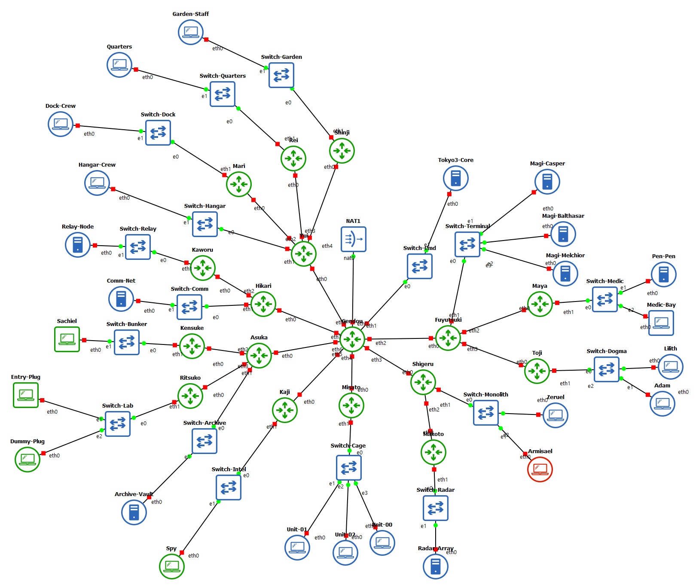

`Gendou` berfungsi sebagai router utama yang menghubungkan jaringan internal Geofront menuju `NAT1` serta tujuh cabang router di bawahnya (`Fuyutsuki`, `Shigeru`, `Misato`, `Kaji`, `Asuka`, `Hikari`, `Yui`) dan segmen `Switch-Cmd`. Seluruh router dan host pada GNS3 menggunakan image `debinet`, terdiri dari 17 router, 17 switch, 16 link point-to-point antar-router, serta 25 container host. Prefix IP kelompok yang digunakan adalah `10.64.0.0/19`.

Perhitungan lengkap VLSM, keterangan rumus, dan pemetaan alamat IP setiap interface node juga terdokumentasi pada berkas [`K-01 Modul 5 Komdat Jarkom 2026.xlsx`](K-01%20Modul%205%20Komdat%20Jarkom%202026.xlsx).

---

### 1. Perancangan Alamat IP (VLSM) dan Pohon Subnet

Pengalamatan jaringan dilakukan menggunakan metode **VLSM (Variable Length Subnet Masking)** dari blok utama `10.64.0.0/19` (8192 IP). Jumlah host pada tabel kebutuhan merupakan host klien aktif sehingga belum termasuk alamat gateway, network ID, dan broadcast:

- **Kebutuhan usable LAN**: `jumlah host klien + 1 gateway router`
- **Kebutuhan usable Link point-to-point**: `2 interface router`
- **Total blok IP minimal**: `kebutuhan usable + 2` (1 Network ID dan 1 Broadcast)
- **Aturan pengurutan (tie-break)**: blok terbesar ke terkecil; jika ukuran blok sama, subnet LAN didahulukan daripada link antar-router; jika sesama LAN berukuran sama, diurutkan sesuai urutan tabel soal.

#### Contoh Perhitungan Satu Subnet (`Switch-Quarters`)

`Switch-Quarters` membutuhkan 500 host klien dan terhubung ke router gateway `Rei`:

1. Kebutuhan usable IP: `500 host + 1 router Rei = 501 IP`.
2. Total alamat IP minimal yang dibutuhkan: `501 + 2 (Network ID + Broadcast) = 503 IP`.
3. Penentuan prefix:
   - Blok `/24` hanya menyediakan `2^8 = 256` alamat IP (254 usable), sehingga tidak mencukupi.
   - Blok `/23` menyediakan `2^9 = 512` alamat IP (`512 - 2 = 510` usable IP), sehingga prefix yang digunakan adalah `/23` dengan netmask `255.255.254.0`.
4. Karena merupakan kebutuhan terbesar, `Switch-Quarters` dialokasikan pertama dari awal blok kelompok:
   - **Network ID**: `10.64.0.0`
   - **Prefix / Netmask**: `/23` (`255.255.254.0`)
   - **Gateway (`Rei` eth1)**: `10.64.0.1`
   - **Range IP Usable**: `10.64.0.1 - 10.64.1.254`
   - **Broadcast**: `10.64.1.255`
   - **IP Terpakai**: `501`
   - **IP Sisa**: `510 - 501 = 9 IP`

#### Tabel Pembagian Alamat IP (33 Subnet)

| No | Nama Subnet | Tipe | Network ID | Prefix | Netmask | Gateway | Broadcast | IP Terpakai | IP Sisa |
| --- | --- | --- | --- | --- | --- | --- | --- | --- | --- |
| 1 | Switch-Quarters | LAN | `10.64.0.0` | `/23` | `255.255.254.0` | `10.64.0.1` | `10.64.1.255` | 501 | 9 |
| 2 | Switch-Comm | LAN | `10.64.2.0` | `/24` | `255.255.255.0` | `10.64.2.1` | `10.64.2.255` | 201 | 53 |
| 3 | Switch-Hangar | LAN | `10.64.3.0` | `/25` | `255.255.255.128` | `10.64.3.1` | `10.64.3.127` | 101 | 25 |
| 4 | Switch-Bunker | LAN | `10.64.3.128` | `/26` | `255.255.255.192` | `10.64.3.129` | `10.64.3.191` | 56 | 6 |
| 5 | Switch-Medic | LAN | `10.64.3.192` | `/27` | `255.255.255.224` | `10.64.3.193` | `10.64.3.223` | 27 | 3 |
| 6 | Switch-Relay | LAN | `10.64.3.224` | `/27` | `255.255.255.224` | `10.64.3.225` | `10.64.3.255` | 26 | 4 |
| 7 | Switch-Garden | LAN | `10.64.4.0` | `/27` | `255.255.255.224` | `10.64.4.1` | `10.64.4.31` | 15 | 15 |
| 8 | Switch-Dock | LAN | `10.64.4.32` | `/28` | `255.255.255.240` | `10.64.4.33` | `10.64.4.47` | 13 | 1 |
| 9 | Switch-Lab | LAN | `10.64.4.48` | `/29` | `255.255.255.248` | `10.64.4.49` | `10.64.4.55` | 6 | 0 |
| 10 | Switch-Terminal | LAN | `10.64.4.56` | `/29` | `255.255.255.248` | `10.64.4.57` | `10.64.4.63` | 4 | 2 |
| 11 | Switch-Cage | LAN | `10.64.4.64` | `/29` | `255.255.255.248` | `10.64.4.65` | `10.64.4.71` | 4 | 2 |
| 12 | Switch-Dogma | LAN | `10.64.4.72` | `/29` | `255.255.255.248` | `10.64.4.73` | `10.64.4.79` | 3 | 3 |
| 13 | Switch-Monolith | LAN | `10.64.4.80` | `/29` | `255.255.255.248` | `10.64.4.81` | `10.64.4.87` | 3 | 3 |
| 14 | Switch-Radar | LAN | `10.64.4.88` | `/29` | `255.255.255.248` | `10.64.4.89` | `10.64.4.95` | 5 | 1 |
| 15 | Switch-Archive | LAN | `10.64.4.96` | `/30` | `255.255.255.252` | `10.64.4.97` | `10.64.4.99` | 2 | 0 |
| 16 | Switch-Intel | LAN | `10.64.4.100` | `/30` | `255.255.255.252` | `10.64.4.101` | `10.64.4.103` | 2 | 0 |
| 17 | Switch-Cmd | LAN | `10.64.4.104` | `/30` | `255.255.255.252` | `10.64.4.105` | `10.64.4.107` | 2 | 0 |
| 18 | Link Gendou - Fuyutsuki | Link | `10.64.4.108` | `/30` | `255.255.255.252` | `10.64.4.109` | `10.64.4.111` | 2 | 0 |
| 19 | Link Gendou - Shigeru | Link | `10.64.4.112` | `/30` | `255.255.255.252` | `10.64.4.113` | `10.64.4.115` | 2 | 0 |
| 20 | Link Gendou - Misato | Link | `10.64.4.116` | `/30` | `255.255.255.252` | `10.64.4.117` | `10.64.4.119` | 2 | 0 |
| 21 | Link Gendou - Kaji | Link | `10.64.4.120` | `/30` | `255.255.255.252` | `10.64.4.121` | `10.64.4.123` | 2 | 0 |
| 22 | Link Gendou - Asuka | Link | `10.64.4.124` | `/30` | `255.255.255.252` | `10.64.4.125` | `10.64.4.127` | 2 | 0 |
| 23 | Link Gendou - Hikari | Link | `10.64.4.128` | `/30` | `255.255.255.252` | `10.64.4.129` | `10.64.4.131` | 2 | 0 |
| 24 | Link Gendou - Yui | Link | `10.64.4.132` | `/30` | `255.255.255.252` | `10.64.4.133` | `10.64.4.135` | 2 | 0 |
| 25 | Link Fuyutsuki - Maya | Link | `10.64.4.136` | `/30` | `255.255.255.252` | `10.64.4.137` | `10.64.4.139` | 2 | 0 |
| 26 | Link Fuyutsuki - Toji | Link | `10.64.4.140` | `/30` | `255.255.255.252` | `10.64.4.141` | `10.64.4.143` | 2 | 0 |
| 27 | Link Shigeru - Makoto | Link | `10.64.4.144` | `/30` | `255.255.255.252` | `10.64.4.145` | `10.64.4.147` | 2 | 0 |
| 28 | Link Asuka - Kensuke | Link | `10.64.4.148` | `/30` | `255.255.255.252` | `10.64.4.149` | `10.64.4.151` | 2 | 0 |
| 29 | Link Asuka - Ritsuko | Link | `10.64.4.152` | `/30` | `255.255.255.252` | `10.64.4.153` | `10.64.4.155` | 2 | 0 |
| 30 | Link Hikari - Kaworu | Link | `10.64.4.156` | `/30` | `255.255.255.252` | `10.64.4.157` | `10.64.4.159` | 2 | 0 |
| 31 | Link Yui - Mari | Link | `10.64.4.160` | `/30` | `255.255.255.252` | `10.64.4.161` | `10.64.4.163` | 2 | 0 |
| 32 | Link Yui - Rei | Link | `10.64.4.164` | `/30` | `255.255.255.252` | `10.64.4.165` | `10.64.4.167` | 2 | 0 |
| 33 | Link Yui - Shinji | Link | `10.64.4.168` | `/30` | `255.255.255.252` | `10.64.4.169` | `10.64.4.171` | 2 | 0 |

#### Pohon Alokasi IP (VLSM)

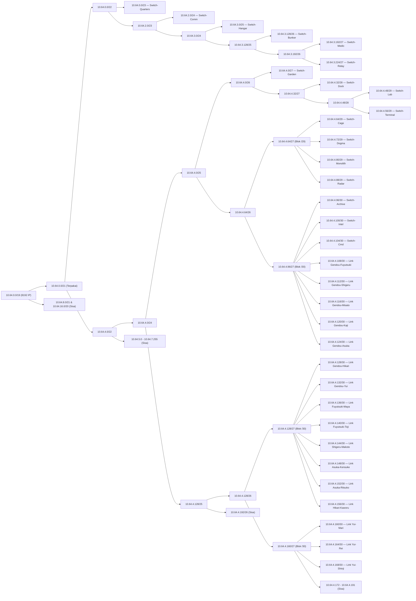

#### Jalur `Dummy-Plug` ke `Armisael`

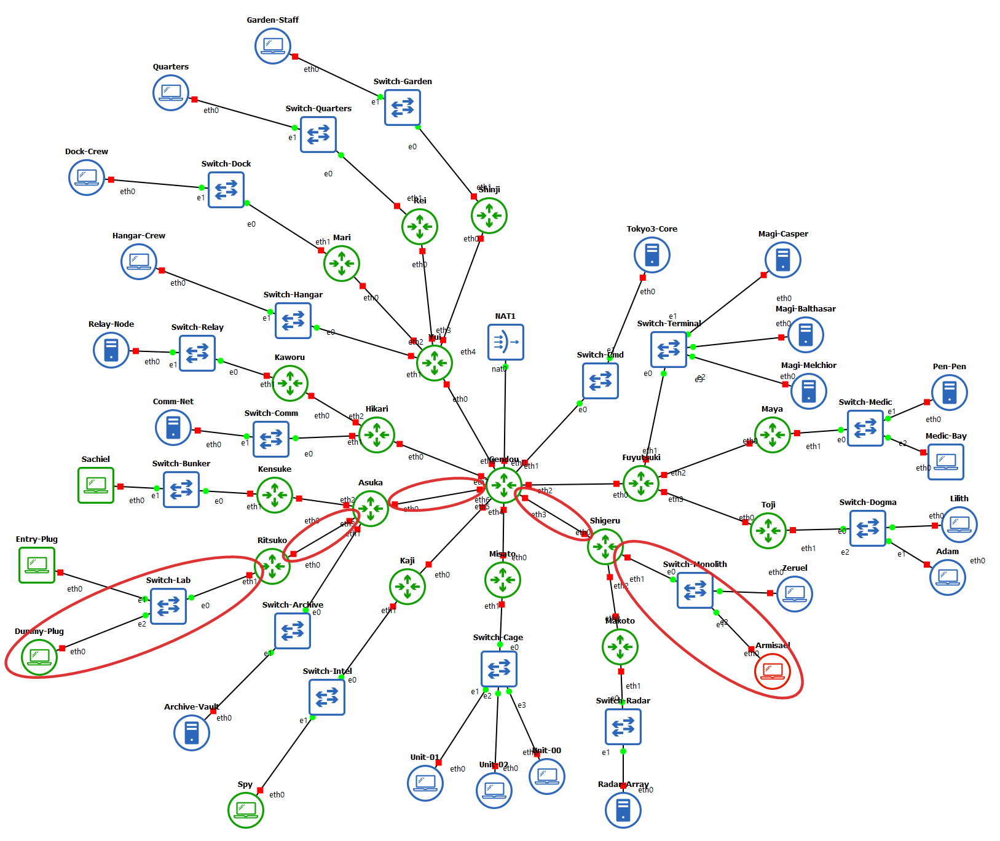

Urutan subnet yang dilalui dari `Dummy-Plug` ke `Armisael`: `Switch-Lab` (`10.64.4.48/29`) → `Ritsuko` → `Link Asuka-Ritsuko` (`10.64.4.152/30`) → `Asuka` → `Link Gendou-Asuka` (`10.64.4.124/30`) → `Gendou` → `Link Gendou-Shigeru` (`10.64.4.112/30`) → `Shigeru` → `Switch-Monolith` (`10.64.4.80/29`) → `Armisael`.

---

### 2. Konfigurasi Interface Router dan IP Forwarding

Seluruh 17 router dikonfigurasi menggunakan skrip `/root/init.sh` pada masing-masing node untuk menetapkan alamat IP di `/etc/network/interfaces`, mengaktifkan interface secara langsung dengan `ip addr add`, serta mengaktifkan IPv4 forwarding (`net.ipv4.ip_forward=1`). Pada `Gendou`, interface `eth0` memperoleh IP WAN secara DHCP dari `NAT1`, sedangkan `eth1` sampai `eth8` dikonfigurasi statis.

Cuplikan konfigurasi interface dan IP forwarding pada [`nodes/Gendou/init.sh`](nodes/Gendou/init.sh):

```bash
cat <<EOF > /etc/network/interfaces
auto lo
iface lo inet loopback

auto eth0
iface eth0 inet dhcp

auto eth1
iface eth1 inet static
    address 10.64.4.105
    netmask 255.255.255.252
...
auto eth8
iface eth8 inet static
    address 10.64.4.133
    netmask 255.255.255.252
EOF

udhcpc -i eth0 -n -q 2>/dev/null || dhclient eth0 2>/dev/null &

ip addr flush dev eth1 2>/dev/null; ip addr add 10.64.4.105/30 dev eth1; ip link set eth1 up
ip addr flush dev eth2 2>/dev/null; ip addr add 10.64.4.109/30 dev eth2; ip link set eth2 up
ip addr flush dev eth3 2>/dev/null; ip addr add 10.64.4.113/30 dev eth3; ip link set eth3 up
ip addr flush dev eth4 2>/dev/null; ip addr add 10.64.4.117/30 dev eth4; ip link set eth4 up
ip addr flush dev eth5 2>/dev/null; ip addr add 10.64.4.121/30 dev eth5; ip link set eth5 up
ip addr flush dev eth6 2>/dev/null; ip addr add 10.64.4.125/30 dev eth6; ip link set eth6 up
ip addr flush dev eth7 2>/dev/null; ip addr add 10.64.4.129/30 dev eth7; ip link set eth7 up
ip addr flush dev eth8 2>/dev/null; ip addr add 10.64.4.133/30 dev eth8; ip link set eth8 up

sysctl -w net.ipv4.ip_forward=1
```

Pengujian dilakukan pada `Gendou` dengan memeriksa status `net.ipv4.ip_forward` dan daftar interface melalui `ip -br a`:

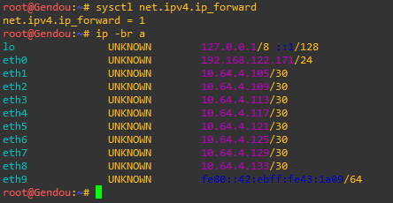

Hasil pengujian menunjukkan `net.ipv4.ip_forward = 1`, `eth0` memperoleh alamat `192.168.122.171/24` dari `NAT1`, serta seluruh interface internal `eth1` hingga `eth8` telah terpasang sesuai tabel VLSM.

---

### 3. Static Routing Antar-Subnet

Agar seluruh segmen jaringan yang terpisah dapat saling berkomunikasi, routing statis diterapkan pada setiap router sesuai struktur hierarki pohon:

- **Router selain `Gendou`**: menggunakan satu `default route` menuju router induk di atasnya dan rute spesifik menuju subnet cabang di bawahnya.
- **Router `Gendou`**: menggunakan `default route` menuju `NAT1` serta 25 rute statis menuju seluruh subnet LAN dan link pada cabang di bawahnya.

Cuplikan tabel rute statis pada [`nodes/Gendou/init.sh`](nodes/Gendou/init.sh):

```bash
# Cabang Fuyutsuki (eth2 -> 10.64.4.110)
ip route replace 10.64.4.56/29 via 10.64.4.110
ip route replace 10.64.4.136/30 via 10.64.4.110
ip route replace 10.64.3.192/27 via 10.64.4.110
ip route replace 10.64.4.140/30 via 10.64.4.110
ip route replace 10.64.4.72/29 via 10.64.4.110

# Cabang Shigeru (eth3 -> 10.64.4.114)
ip route replace 10.64.4.80/29 via 10.64.4.114
ip route replace 10.64.4.144/30 via 10.64.4.114
ip route replace 10.64.4.88/29 via 10.64.4.114

# Cabang Misato, Kaji, Asuka, Hikari, Yui
ip route replace 10.64.4.64/29 via 10.64.4.118
ip route replace 10.64.4.100/30 via 10.64.4.122
ip route replace 10.64.4.96/30 via 10.64.4.126
ip route replace 10.64.4.148/30 via 10.64.4.126
ip route replace 10.64.3.128/26 via 10.64.4.126
ip route replace 10.64.4.152/30 via 10.64.4.126
ip route replace 10.64.4.48/29 via 10.64.4.126
ip route replace 10.64.2.0/24 via 10.64.4.130
ip route replace 10.64.4.156/30 via 10.64.4.130
ip route replace 10.64.3.224/27 via 10.64.4.130
ip route replace 10.64.3.0/25 via 10.64.4.134
ip route replace 10.64.4.160/30 via 10.64.4.134
ip route replace 10.64.4.32/28 via 10.64.4.134
ip route replace 10.64.4.164/30 via 10.64.4.134
ip route replace 10.64.0.0/23 via 10.64.4.134
ip route replace 10.64.4.168/30 via 10.64.4.134
ip route replace 10.64.4.0/27 via 10.64.4.134
```

Contoh rute pada router cabang [`nodes/Fuyutsuki/init.sh`](nodes/Fuyutsuki/init.sh):

```bash
ip route replace default via 10.64.4.109
ip route replace 10.64.3.192/27 via 10.64.4.138
ip route replace 10.64.4.72/29 via 10.64.4.142
```

Pengujian dilakukan dari `Armisael` (`Switch-Monolith`, `10.64.4.83`) dengan melakukan ping lintas cabang menuju `Lilith` (`10.64.4.74`), `Sachiel` (`10.64.3.130`), dan `Comm-Net` (`10.64.2.2`) melalui [`nodes/Armisael/test-quest-3.sh`](nodes/Armisael/test-quest-3.sh):

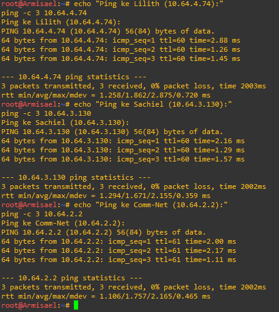

Hasil pengujian menunjukkan ketiga tujuan pada cabang yang berbeda dapat dijangkau dengan `0% packet loss`, membuktikan static routing pada seluruh router berjalan sesuai jalur yang dirancang.

---

### 4. NAT Masquerade dan Resolver DNS

Untuk menyediakan akses internet kepada seluruh host internal, NAT masquerade diterapkan pada router `Gendou` ([`nodes/Gendou/quest-4-5.sh`](nodes/Gendou/quest-4-5.sh)). Translasi alamat dibatasi hanya untuk trafik yang berasal dari prefix internal `10.64.0.0/19` yang keluar melalui interface WAN `eth0`. Resolver DNS juga ditetapkan pada `/etc/resolv.conf` di seluruh node menggunakan `192.168.122.1` dan `8.8.8.8`.

Konfigurasi NAT dan resolver pada [`nodes/Gendou/quest-4-5.sh`](nodes/Gendou/quest-4-5.sh):

```bash
iptables -t nat -F POSTROUTING
iptables -t nat -A POSTROUTING -o eth0 -s 10.64.0.0/19 -j MASQUERADE

cat <<EOF > /etc/resolv.conf
nameserver 192.168.122.1
nameserver 8.8.8.8
EOF
```

Pengujian dilakukan dengan menjalankan ping ke `8.8.8.8` dan `deb.debian.org` dari `Armisael` ([`nodes/Armisael/test-quest-4-5.sh`](nodes/Armisael/test-quest-4-5.sh)), lalu memeriksa counter paket NAT pada `Gendou` melalui `iptables -t nat -L -v -n`:

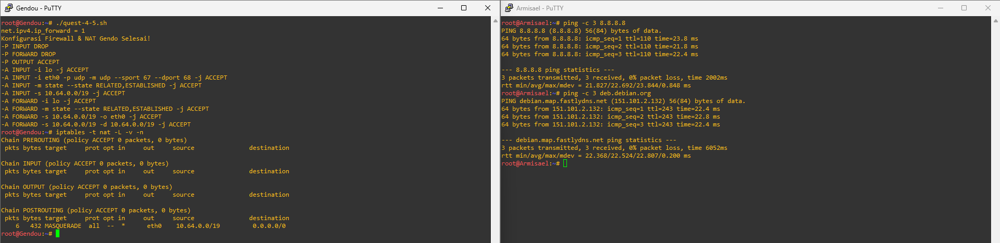

Hasil pengujian menunjukkan `Armisael` berhasil menjangkau `8.8.8.8` dan menerjemahkan nama domain `deb.debian.org` (`151.101.2.132`) dengan `0% packet loss`. Pada sisi `Gendou`, tabel NAT menampilkan counter rule `MASQUERADE` bertambah (`6 pkts, 432 bytes`) sesuai trafik keluar yang ditranslasikan.

---

### 5. Firewall Router Gendou

Router `Gendou` diamankan dengan kebijakan stateful firewall pada [`nodes/Gendou/quest-4-5.sh`](nodes/Gendou/quest-4-5.sh). Kebijakan default ditetapkan `DROP` pada chain `INPUT` dan `FORWARD`, serta `ACCEPT` pada chain `OUTPUT`. Pengecualian diberikan untuk interface loopback, DHCP client pada `eth0` (UDP port 67 ke 68), paket balasan `ESTABLISHED,RELATED`, trafik keluar dari `10.64.0.0/19` ke `eth0`, trafik antar-LAN `10.64.0.0/19`, dan trafik internal menuju `Gendou`.

Konfigurasi firewall pada [`nodes/Gendou/quest-4-5.sh`](nodes/Gendou/quest-4-5.sh):

```bash
iptables -P INPUT DROP
iptables -P FORWARD DROP
iptables -P OUTPUT ACCEPT

iptables -F INPUT
iptables -F FORWARD

iptables -A INPUT -i lo -j ACCEPT
iptables -A FORWARD -i lo -j ACCEPT

iptables -A INPUT -i eth0 -p udp --sport 67 --dport 68 -j ACCEPT

iptables -A INPUT -m state --state ESTABLISHED,RELATED -j ACCEPT
iptables -A FORWARD -m state --state ESTABLISHED,RELATED -j ACCEPT

iptables -A FORWARD -s 10.64.0.0/19 -o eth0 -j ACCEPT
iptables -A FORWARD -s 10.64.0.0/19 -d 10.64.0.0/19 -j ACCEPT
iptables -A INPUT -s 10.64.0.0/19 -j ACCEPT
```

Pengujian dilakukan dengan memeriksa aturan aktif melalui `iptables -S` pada `Gendou`, serta memastikan koneksi internet dari `Armisael` ke `8.8.8.8` tetap berjalan:

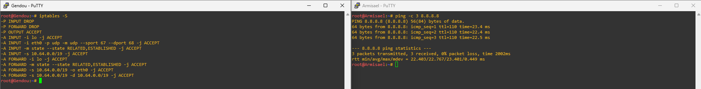

Hasil pengujian menunjukkan seluruh aturan firewall aktif dengan default policy `INPUT DROP` dan `FORWARD DROP`, namun trafik outbound beserta balasannya dari jaringan internal ke internet tetap dapat melewati `Gendou` dengan `0% packet loss`.

---

### 6. Konfigurasi IP Statis Permanen pada Seluruh Host

Seluruh 25 host dikonfigurasi dengan alamat IP statis permanen pada `/etc/network/interfaces` menggunakan skrip `init.sh` masing-masing node agar pengaturan tetap bertahan saat container di-restart.

Daftar alokasi alamat IP seluruh host:

| Host | Subnet | IP Address | Gateway |
| --- | --- | --- | --- |
| Quarters | Switch-Quarters | `10.64.0.2/23` | `10.64.0.1` |
| Comm-Net | Switch-Comm | `10.64.2.2/24` | `10.64.2.1` |
| Hangar-Crew | Switch-Hangar | `10.64.3.2/25` | `10.64.3.1` |
| Sachiel | Switch-Bunker | `10.64.3.130/26` | `10.64.3.129` |
| Pen-Pen, Medic-Bay | Switch-Medic | `10.64.3.194/27`, `10.64.3.195/27` | `10.64.3.193` |
| Relay-Node | Switch-Relay | `10.64.3.226/27` | `10.64.3.225` |
| Garden-Staff | Switch-Garden | `10.64.4.2/27` | `10.64.4.1` |
| Dock-Crew | Switch-Dock | `10.64.4.34/28` | `10.64.4.33` |
| Entry-Plug, Dummy-Plug | Switch-Lab | `10.64.4.50/29`, `10.64.4.51/29` | `10.64.4.49` |
| Magi-Casper, Balthasar, Melchior | Switch-Terminal | `10.64.4.58/29`, `10.64.4.59/29`, `10.64.4.60/29` | `10.64.4.57` |
| Unit-01, Unit-02, Unit-00 | Switch-Cage | `10.64.4.66/29`, `10.64.4.67/29`, `10.64.4.68/29` | `10.64.4.65` |
| Lilith, Adam | Switch-Dogma | `10.64.4.74/29`, `10.64.4.75/29` | `10.64.4.73` |
| Zeruel, Armisael | Switch-Monolith | `10.64.4.82/29`, `10.64.4.83/29` | `10.64.4.81` |
| Radar-Array | Switch-Radar | `10.64.4.90/29` | `10.64.4.89` |
| Archive-Vault | Switch-Archive | `10.64.4.98/30` | `10.64.4.97` |
| Spy | Switch-Intel | `10.64.4.102/30` | `10.64.4.101` |
| Tokyo3-Core | Switch-Cmd | `10.64.4.106/30` | `10.64.4.105` |

Contoh konfigurasi pada [`nodes/Unit-01/init.sh`](nodes/Unit-01/init.sh):

```bash
cat <<EOF > /etc/network/interfaces
auto lo
iface lo inet loopback

auto eth0
iface eth0 inet static
    address 10.64.4.66
    netmask 255.255.255.248
    gateway 10.64.4.65
EOF

ip addr flush dev eth0 2>/dev/null
ip addr add 10.64.4.66/29 dev eth0
ip link set eth0 up
ip route replace default via 10.64.4.65
```

Pengujian dilakukan pada `Unit-01` dengan memeriksa isi `/etc/network/interfaces`, `ip -br a`, serta ping menuju gateway `Misato` (`10.64.4.65`):

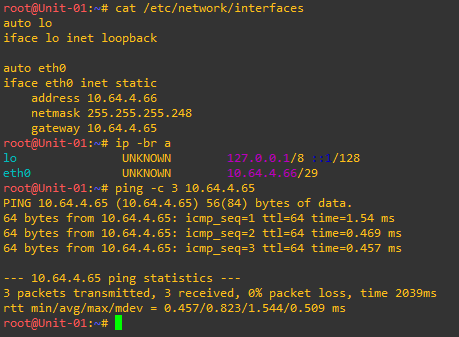

Hasil pengujian menunjukkan konfigurasi statis tersimpan pada `/etc/network/interfaces`, interface `eth0` aktif dengan alamat `10.64.4.66/29`, dan koneksi ke gateway lokal berjalan dengan `0% packet loss`.

---

### 7. Aktivasi Layanan Netcat Cluster MAGI

Paket `netcat-traditional` dan `iptables` dipasang pada ketiga node cluster MAGI (`Magi-Casper`, `Magi-Balthasar`, `Magi-Melchior`), kemudian listener TCP dijalankan di background:

- `Magi-Casper` (`10.64.4.58`, [`nodes/Magi-Casper/quest-7.sh`](nodes/Magi-Casper/quest-7.sh)): port `5000`
- `Magi-Balthasar` (`10.64.4.59`, [`nodes/Magi-Balthasar/quest-7.sh`](nodes/Magi-Balthasar/quest-7.sh)): port `5000` dan `5001`
- `Magi-Melchior` (`10.64.4.60`, [`nodes/Magi-Melchior/quest-7.sh`](nodes/Magi-Melchior/quest-7.sh)): port `5000`

Konfigurasi pada [`nodes/Magi-Balthasar/quest-7.sh`](nodes/Magi-Balthasar/quest-7.sh):

```bash
apt-get update && apt-get install -y netcat-traditional iptables
pkill -f "nc -l -p 5000" 2>/dev/null
pkill -f "nc -l -p 5001" 2>/dev/null
nc -l -p 5000 -k &
nc -l -p 5001 -k &
```

Pengujian dilakukan dari `Lilith` dengan mengirim pesan menuju masing-masing port MAGI menggunakan `nc -w 2`:

```bash
echo "Test dari Lilith ke Casper Masuk" | nc -w 2 10.64.4.58 5000
echo "Test dari Lilith ke Balthasar port 5000" | nc -w 2 10.64.4.59 5000
echo "Test dari Lilith ke Balthasar port 5001" | nc -w 2 10.64.4.59 5001
echo "Test dari Lilith ke Melchior Masuk" | nc -w 2 10.64.4.60 5000
```

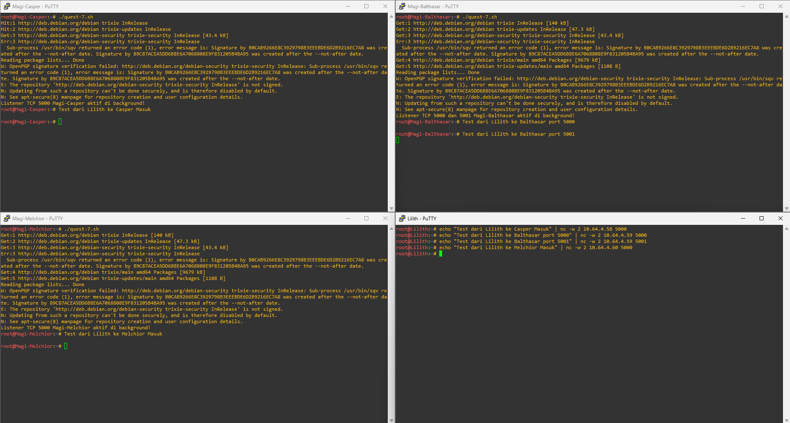

Hasil pengujian menunjukkan seluruh pesan yang dikirim dari `Lilith` diterima dan tampil pada terminal `Magi-Casper`, `Magi-Balthasar` (port `5000` dan `5001`), serta `Magi-Melchior`.

---

### 8. Pengujian Kondisi Normal Layanan Pen-Pen dan Tokyo3-Core

Layanan respon teks dijalankan menggunakan loop `netcat-traditional` pada `Pen-Pen` ([`nodes/Pen-Pen/quest-8.sh`](nodes/Pen-Pen/quest-8.sh)) dan `Tokyo3-Core` ([`nodes/Tokyo3-Core/quest-8.sh`](nodes/Tokyo3-Core/quest-8.sh)):

- `Pen-Pen` (`10.64.3.194`): port `80` merespons `Welcome to Pen-Pen`.
- `Tokyo3-Core` (`10.64.4.106`): port `80` merespons `Welcome to Tokyo3-Core` dan port `8080` merespons `syifa imutz`.

Konfigurasi pada [`nodes/Tokyo3-Core/quest-8.sh`](nodes/Tokyo3-Core/quest-8.sh):

```bash
apt-get update && apt-get install -y netcat-traditional
pkill -f "nc -l -p 80" 2>/dev/null
pkill -f "nc -l -p 8080" 2>/dev/null

while true; do
    echo "Welcome to Tokyo3-Core" | nc -l -p 80
done &

while true; do
    echo "syifa imutz" | nc -l -p 8080
done &
```

Pengujian dilakukan dari `Lilith` melalui [`nodes/Lilith/test-quest-8.sh`](nodes/Lilith/test-quest-8.sh) menuju port `80` `Pen-Pen`, port `80` dan `8080` `Tokyo3-Core`, serta port `22` `Tokyo3-Core` yang tidak aktif:

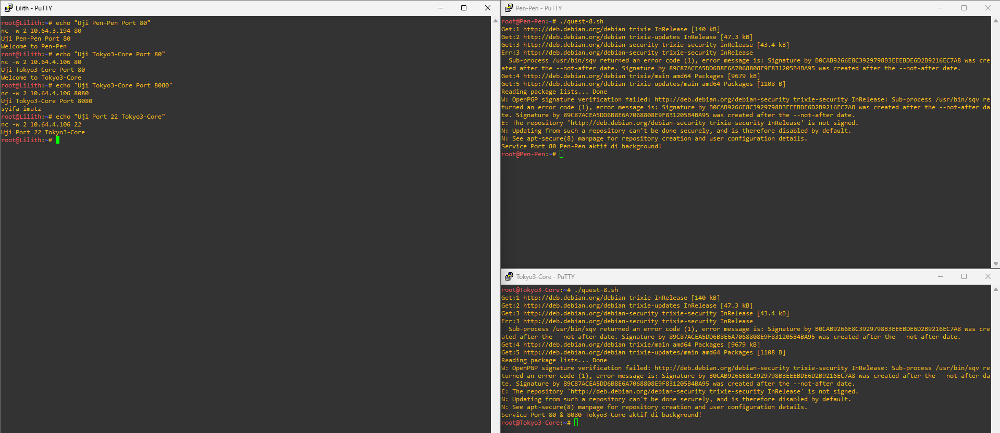

Hasil pengujian menunjukkan `Lilith` menerima teks `Welcome to Pen-Pen`, `Welcome to Tokyo3-Core`, dan `syifa imutz` pada port layanan yang aktif, sedangkan koneksi ke port `22` `Tokyo3-Core` langsung berhenti tanpa menunggu timeout karena port tersebut tidak mendengarkan koneksi.

---

### 9. Pemulihan Sabotase Routing pada Router Shigeru

Setelah skrip sabotase `break_routing.sh` dijalankan pada router `Shigeru`, komunikasi dari `Lilith` (`10.64.4.74`) menuju `Armisael` (`10.64.4.83`) terputus meskipun `Armisael` tetap dapat menjangkau gateway lokalnya (`10.64.4.81`).

Berdasarkan pemeriksaan isi `break_routing.sh` dan status router `Shigeru`, terdapat lima gangguan yang diterapkan:

1. `echo 0 > /proc/sys/net/ipv4/ip_forward` menonaktifkan penerusan paket antar-interface pada `Shigeru`.
2. `ip route replace default via $MKGW dev $MKIF` membelokkan default route menuju `Makoto`, bukan ke `Gendou`.
3. `ip route add blackhole 10.64.4.72/29` membuang seluruh paket menuju subnet `Switch-Dogma` (`Lilith` dan `Adam`).
4. `ip route add unreachable default table 100` mengisi routing table `100` dengan rute `unreachable`.
5. `ip rule add iif eth1 lookup 100 priority 90` mengarahkan seluruh paket yang masuk dari `Switch-Monolith` (`eth1`) agar memakai `table 100`.

Perbaikan dijalankan pada `Shigeru` menggunakan [`nodes/Shigeru/quest-9.sh`](nodes/Shigeru/quest-9.sh):

```bash
sysctl -w net.ipv4.ip_forward=1

while ip rule del priority 90 2>/dev/null; do :; done
while ip rule del lookup 100 2>/dev/null; do :; done
ip route flush table 100 2>/dev/null

ip route del blackhole 10.64.4.72/29 2>/dev/null

ip route replace default via 10.64.4.113 dev eth0
ip route replace 10.64.4.88/29 via 10.64.4.146 dev eth2
```

Pengujian dilakukan dengan menjalankan ping dari `Lilith` menuju `Armisael` (`10.64.4.83`):

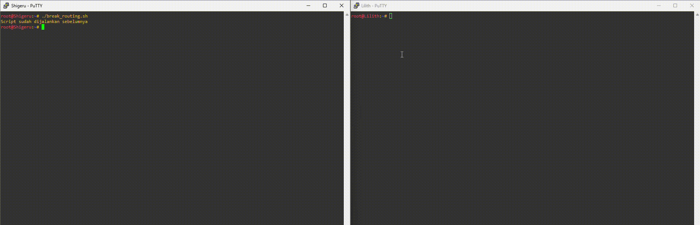

Hasil pengujian menunjukkan setelah kelima sabotase dibersihkan pada `Shigeru`, `Lilith` kembali dapat melakukan ping ke `Armisael` dengan `0% packet loss`.

---

### 10. Pemulihan Sabotase NAT pada Router Misato dan Gendou

Setelah skrip sabotase `break_nat.sh` dijalankan pada `Misato` dan `Gendou`, host di `Switch-Cage` (`Unit-01`, `Unit-02`, `Unit-00`) tidak dapat melakukan ping ke `8.8.8.8`, sementara `Spy` di `Switch-Intel` tidak terdampak dan ping dari `Switch-Cage` menuju `Lilith` tetap berhasil.

Analisis penyebab:

1. **Pada `Misato`**: skrip menambahkan rule `SNAT` (`-s 10.64.4.64/29 ! -d 10.64.0.0/16 -o eth0 -j SNAT --to-source 172.31.99.1`). Paket dari `Switch-Cage` menuju internet diubah alamat sumbernya menjadi `172.31.99.1`, sehingga tidak cocok dengan rule NAT dan firewall di `Gendou`. Kondisi `! -d 10.64.0.0/16` membuat trafik internal seperti ping ke `Lilith` tetap berjalan normal.
2. **Pada `Gendou`**: skrip menyisipkan rule `RETURN` pada posisi pertama chain `POSTROUTING` khusus untuk subnet `10.64.4.64/29` (`-I POSTROUTING 1 -s 10.64.4.64/29 -o eth0 -j RETURN`), sehingga trafik dari `Switch-Cage` melewati proses `MASQUERADE`. Subnet `Switch-Intel` (`Spy`) di bawah `Kaji` tidak terdampak karena kedua rule tersebut hanya menargetkan subnet `Switch-Cage`.
3. **Lokasi translasi alamat yang benar**: translasi alamat sumber (NAT) seharusnya hanya dilakukan pada router `Gendou` di interface `eth0` yang menghadap `NAT1`, bukan pada router perantara seperti `Misato`.

Perbaikan dijalankan pada `Misato` ([`nodes/Misato/quest-10.sh`](nodes/Misato/quest-10.sh)) dan `Gendou` ([`nodes/Gendou/quest-10.sh`](nodes/Gendou/quest-10.sh)):

```bash
# Pada Misato
iptables -F
iptables -t nat -F
iptables -P INPUT ACCEPT
iptables -P FORWARD ACCEPT
iptables -P OUTPUT ACCEPT
sysctl -w net.ipv4.ip_forward=1
ip route replace default via 10.64.4.117 dev eth0

# Pada Gendou
iptables -t nat -F POSTROUTING
iptables -t nat -A POSTROUTING -o eth0 -s 10.64.0.0/19 -j MASQUERADE
```

Pengujian dilakukan dari `Unit-01` dengan menjalankan `ping -c 3 8.8.8.8`:

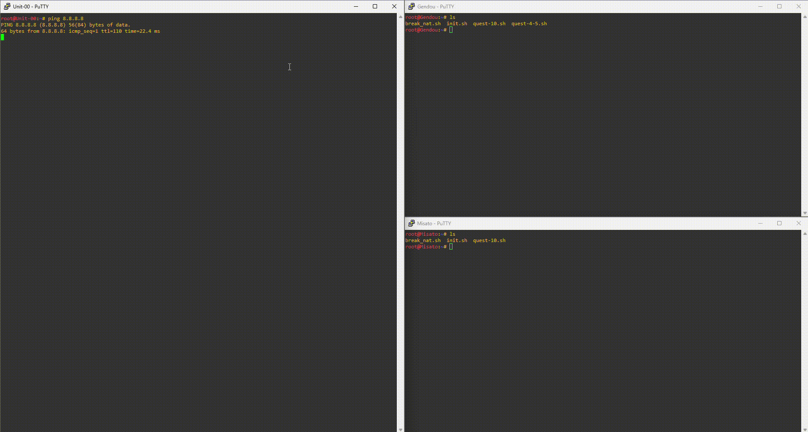

Hasil pengujian menunjukkan setelah tabel NAT `Misato` dibersihkan dan rule `RETURN` pada `Gendou` dihapus, `Unit-01` kembali memperoleh balasan ping dari `8.8.8.8` dengan `0% packet loss`.

---

### 11. Hardening ICMP pada Magi-Casper

Pada `Magi-Casper` (`10.64.4.58`), aturan firewall dikonfigurasi melalui [`nodes/Magi-Casper/quest-11.sh`](nodes/Magi-Casper/quest-11.sh) agar tidak ada host lain yang dapat melakukan ping ke Casper, namun Casper sendiri tetap dapat melakukan ping keluar dan layanan TCP port `5000` tetap dapat diakses.

Konfigurasi pada [`nodes/Magi-Casper/quest-11.sh`](nodes/Magi-Casper/quest-11.sh):

```bash
iptables -F INPUT
iptables -A INPUT -i lo -j ACCEPT
iptables -A INPUT -m state --state ESTABLISHED,RELATED -j ACCEPT
iptables -A INPUT -p tcp --dport 5000 -j ACCEPT
iptables -A INPUT -p icmp --icmp-type echo-request -j DROP
```

Pengujian dilakukan dengan tiga skenario: ping dari `Magi-Balthasar` dan `Lilith` ke `10.64.4.58`, ping keluar dari `Magi-Casper` ke `10.64.4.59` dan `10.64.4.74`, serta uji koneksi port `5000` dari `Unit-00` menggunakan `nc -zv 10.64.4.58 5000`:

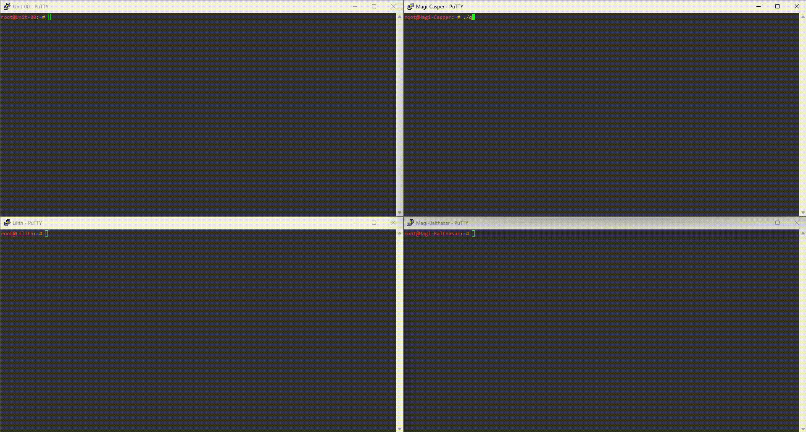

Hasil pengujian menunjukkan ping dari perangkat lain menuju `Magi-Casper` gagal (`100% packet loss`), `Magi-Casper` tetap menerima balasan saat melakukan ping keluar karena aturan `ESTABLISHED,RELATED`, dan koneksi `Unit-00` menuju port `5000` tetap berhasil.

---

### 12. Pemulihan Sabotase Firewall pada Magi-Casper

Setelah skrip sabotase `break_fw.sh` dijalankan pada `Magi-Casper`, Casper tidak dapat melakukan `apt-get update` maupun ping ke `8.8.8.8`, dan `Unit-00` gagal terhubung ke TCP port `5000`.

Analisis penyebab dari `break_fw.sh`:

1. `iptables -A OUTPUT -p udp --dport 53 -j DROP` memblokir query DNS keluar pada port 53 UDP sehingga resolusi domain repositori gagal.
2. `iptables -P INPUT DROP` diterapkan tanpa aturan `ESTABLISHED,RELATED`, sehingga seluruh paket balasan dari koneksi yang diinisiasi Casper (balasan HTTP `apt` maupun `echo-reply`) ditolak.
3. `iptables -A INPUT -p icmp -j DROP` memblokir seluruh tipe ICMP termasuk `echo-reply`.
4. Tidak terdapat aturan yang mengizinkan trafik masuk ke TCP port `5000`.

Perbaikan dijalankan pada `Magi-Casper` menggunakan [`nodes/Magi-Casper/quest-12.sh`](nodes/Magi-Casper/quest-12.sh) dengan tetap mempertahankan kebijakan `INPUT DROP` dan proteksi anti-ping dari soal sebelumnya:

```bash
iptables -F INPUT
iptables -F OUTPUT

iptables -P INPUT DROP
iptables -P FORWARD DROP
iptables -P OUTPUT ACCEPT

iptables -A INPUT -i lo -j ACCEPT
iptables -A INPUT -m state --state ESTABLISHED,RELATED -j ACCEPT
iptables -A INPUT -p tcp --dport 5000 -j ACCEPT
iptables -A INPUT -p icmp --icmp-type echo-request -j DROP
```

Pengujian dilakukan dengan menjalankan `apt-get update` dan `ping -c 3 8.8.8.8` di `Magi-Casper`, `nc -zv 10.64.4.58 5000` di `Unit-00`, serta `ping -c 3 -W 2 10.64.4.58` di `Lilith`:

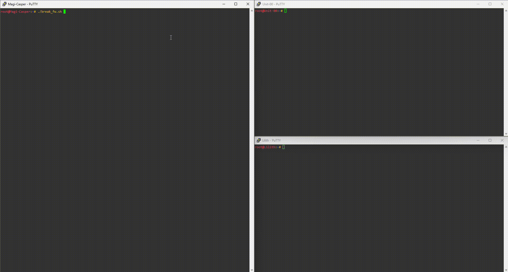

Hasil pengujian menunjukkan `Magi-Casper` kembali dapat melakukan resolusi DNS, `apt-get update`, dan ping ke `8.8.8.8`; `Unit-00` kembali dapat mengakses layanan TCP port `5000`; serta ping dari `Lilith` menuju `Magi-Casper` tetap ditolak sesuai ketentuan hardening.

---

### 13. Pembatasan Akses Brankas Magi-Balthasar

Pada `Magi-Balthasar` (`10.64.4.59`), layanan TCP port `5000` dan `5001` dibatasi melalui [`nodes/Magi-Balthasar/quest-13.sh`](nodes/Magi-Balthasar/quest-13.sh) agar hanya dapat diakses oleh `Magi-Casper` (`10.64.4.58`) dan seluruh kategori Pilot (`Unit-01` `10.64.4.66`, `Unit-02` `10.64.4.67`, `Unit-00` `10.64.4.68`, dan `Sachiel` `10.64.3.130`). Seluruh node lain, termasuk tetangga satu switch seperti `Magi-Melchior`, langsung ditolak menggunakan target `REJECT --reject-with tcp-reset` agar koneksi langsung gagal tanpa menunggu timeout. Kebijakan default `INPUT ACCEPT` dipertahankan sehingga lalu lintas lain dan ping dari `Magi-Balthasar` ke `8.8.8.8` tetap berjalan normal.

Konfigurasi pada [`nodes/Magi-Balthasar/quest-13.sh`](nodes/Magi-Balthasar/quest-13.sh):

```bash
iptables -F INPUT
iptables -P INPUT ACCEPT
iptables -P OUTPUT ACCEPT

iptables -A INPUT -i lo -j ACCEPT
iptables -A INPUT -m state --state ESTABLISHED,RELATED -j ACCEPT

ALLOWED_IPS="10.64.4.58,10.64.4.66,10.64.4.67,10.64.4.68,10.64.3.130"
iptables -A INPUT -s $ALLOWED_IPS -p tcp -m multiport --dports 5000,5001 -j ACCEPT
iptables -A INPUT -p tcp -m multiport --dports 5000,5001 -j REJECT --reject-with tcp-reset
```

Pengujian dilakukan terhadap port `5000` dan `5001` `Magi-Balthasar` dari `Unit-01` ([`nodes/Unit-01/test-quest-13.sh`](nodes/Unit-01/test-quest-13.sh)), `Lilith` ([`nodes/Lilith/test-quest-13.sh`](nodes/Lilith/test-quest-13.sh)), dan `Magi-Melchior` ([`nodes/Magi-Melchior/test-quest-13.sh`](nodes/Magi-Melchior/test-quest-13.sh)), disertai pengujian `ping -c 3 8.8.8.8` dari `Magi-Balthasar`:

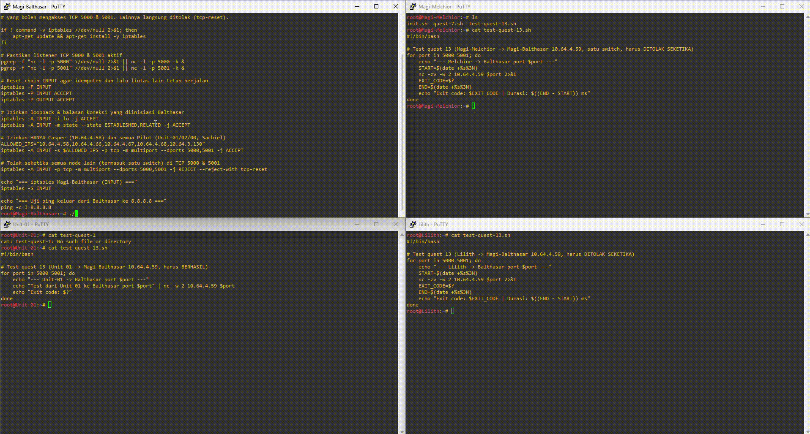

Hasil pengujian menunjukkan `Unit-01` berhasil mengirim pesan ke port `5000` dan `5001` `Magi-Balthasar` (`Exit code: 0` dan pesan tampil di terminal `Magi-Balthasar`), `Lilith` (`3–4 ms`) dan `Magi-Melchior` (`5 ms`) langsung menerima `Connection refused` (`Exit code: 1`) tanpa menunggu timeout, serta `Magi-Balthasar` tetap berhasil melakukan ping ke `8.8.8.8` dengan `0% packet loss`.

---

### 13. Pembatasan Akses Brankas Magi-Balthasar

Pada `Magi-Balthasar` (`10.64.4.59`), layanan TCP port `5000` dan `5001` dibatasi melalui [`nodes/Magi-Balthasar/quest-13.sh`](nodes/Magi-Balthasar/quest-13.sh) agar hanya dapat diakses oleh `Magi-Casper` (`10.64.4.58`) dan seluruh kategori Pilot (`Unit-01` `10.64.4.66`, `Unit-02` `10.64.4.67`, `Unit-00` `10.64.4.68`, dan `Sachiel` `10.64.3.130`). Seluruh node lain, termasuk tetangga satu switch seperti `Magi-Melchior`, langsung ditolak menggunakan target `REJECT --reject-with tcp-reset` agar koneksi langsung gagal tanpa menunggu timeout. Kebijakan default `INPUT ACCEPT` dipertahankan sehingga lalu lintas lain dan ping dari `Magi-Balthasar` ke `8.8.8.8` tetap berjalan normal.

Konfigurasi pada [`nodes/Magi-Balthasar/quest-13.sh`](nodes/Magi-Balthasar/quest-13.sh):

```bash
iptables -F INPUT
iptables -P INPUT ACCEPT
iptables -P OUTPUT ACCEPT

iptables -A INPUT -i lo -j ACCEPT
iptables -A INPUT -m state --state ESTABLISHED,RELATED -j ACCEPT

ALLOWED_IPS="10.64.4.58,10.64.4.66,10.64.4.67,10.64.4.68,10.64.3.130"
iptables -A INPUT -s $ALLOWED_IPS -p tcp -m multiport --dports 5000,5001 -j ACCEPT
iptables -A INPUT -p tcp -m multiport --dports 5000,5001 -j REJECT --reject-with tcp-reset
```

Pengujian dilakukan terhadap port `5000` dan `5001` `Magi-Balthasar` dari `Unit-01` ([`nodes/Unit-01/test-quest-13.sh`](nodes/Unit-01/test-quest-13.sh)), `Lilith` ([`nodes/Lilith/test-quest-13.sh`](nodes/Lilith/test-quest-13.sh)), dan `Magi-Melchior` ([`nodes/Magi-Melchior/test-quest-13.sh`](nodes/Magi-Melchior/test-quest-13.sh)), disertai pengujian `ping -c 3 8.8.8.8` dari `Magi-Balthasar`:


Hasil pengujian menunjukkan `Unit-01` berhasil mengirim pesan ke port `5000` dan `5001` `Magi-Balthasar` (`Exit code: 0` dan pesan tampil di terminal `Magi-Balthasar`), `Lilith` (`3–4 ms`) dan `Magi-Melchior` (`5 ms`) langsung menerima `Connection refused` (`Exit code: 1`) tanpa menunggu timeout, serta `Magi-Balthasar` tetap berhasil melakukan ping ke `8.8.8.8` dengan `0% packet loss`.
